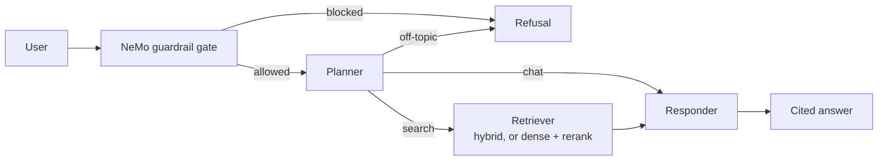

# Agentic RAG Assistant with Guardrails and Evaluation

A document Q&A assistant that answers questions about Kubernetes and Databricks job automation from a small document set. It routes each message through a safety gate and a planner, retrieves with hybrid search (dense + BM25), and returns cited answers. The project also includes an evaluation suite that was used to find and fix real problems in the system.

<!-- TODO: add a screenshot, e.g. docs/screenshot.png -->
<!--  -->

## Features

- **Ingestion:** PDF, HTML, DOCX, PPTX and TXT loaders, paragraph chunking (max 1,500 characters), Gemini embeddings, Qdrant Cloud. Stable chunk IDs make re-ingestion safe.
- **Retrieval:** dense search, a FlashRank reranker, and hybrid search (dense + BM25, fused with reciprocal rank fusion). A `RETRIEVAL_MODE` setting switches between them.
- **Agent (LangGraph):** a planner routes each message to `chat`, `search` or `off_topic`. It rewrites only follow-up questions. The responder answers only from retrieved context, cites sources as `[n]`, and says so when the answer is not in the documents. Memory is kept per conversation (`thread_id`).
- **Guardrails:** a NeMo Guardrails gate (jailbreaks, system-prompt extraction, harmful requests, off-topic) plus the planner's scope check as a second layer.
- **LLM gateway:** Portkey with retries on 429/503 and a fallback model.
- **API and UI:** FastAPI backend and an HTML/CSS/JS chat page that shows the route, rewritten search query and sources for each answer.
- **Evaluation suite:** retrieval, guardrails, end-to-end behaviour and an LLM judge (details below).

## Architecture



## Tech stack

Python 3.13, LangGraph, FastAPI, Qdrant, Gemini embeddings, fastembed (BM25), FlashRank, NeMo Guardrails, Portkey (gateway to Groq models), JavaScript.

## Setup

These commands are for Windows PowerShell. `requirements.txt` was generated on Windows, so it may need adjusting on Linux or macOS. NeMo Guardrails depends on a package that may need the Microsoft C++ Build Tools to install on Windows.

```powershell
git clone <TODO: your repo URL>
cd <repo folder>
python -m venv venv
.\venv\Scripts\Activate.ps1
python -m pip install -r requirements.txt
```

### Accounts and keys

| Service | Used for |
|---|---|
| Google AI Studio (Gemini) | Embeddings |
| Qdrant Cloud | Vector database |
| Groq | LLM inference |
| Portkey | Gateway with retries and fallback |

In Portkey, add Groq as two providers (for example slugs `rag` and `rag2`) and save a config:

```json
{
  "strategy": { "mode": "fallback" },
  "retry": { "attempts": 2, "on_status_codes": [429, 503] },
  "targets": [
    { "override_params": { "model": "@rag/openai/gpt-oss-20b" } },
    { "override_params": { "model": "@rag2/qwen/qwen3.8-27b" } }
  ]
}
```

Provider model names change over time (Groq retired its Llama models in August 2026), so check the current list.

### `.env`

```env
GEMINI_API_KEY=...
QDRANT_CLUSTER_ENDPOINT=https://<cluster>.cloud.qdrant.io:6333
QDRANT_API_KEY=...
PORTKEY_API_KEY=...
PORTKEY_CONFIG_ID=pc-...
GROQ_SLUG=rag
GROQ_SLUG_2=rag2
RETRIEVAL_MODE=hybrid    # dense_rerank | hybrid | hybrid_rerank
```

### Index the documents

```powershell
python -m app.ingestion.processor DATA\true_data --wipe
python -m app.ingestion.processor DATA\noisy_data --max-chunks 40
python -m app.services.retrieval.build_hybrid
```

The last command copies the vectors into a second collection and adds BM25 vectors, so hybrid search works. Re-run it whenever you re-ingest documents.

### Run

```powershell
uvicorn app.main:app --port 8000
```

Open http://127.0.0.1:8000. Restart the server after changing `.env`.

### API

`POST /query`

```json
{ "question": "How does the Horizontal Pod Autoscaler work?", "thread_id": "optional-conversation-id" }
```

Returns `answer`, `route` (`search`, `chat`, `off_topic` or `guardrail`), `search_query`, `sources` and `thread_id`. `GET /health` returns `{"status": "ok"}`.

## Evaluation

The document set has 6 target documents (74 chunks) plus 271 chunks from unrelated papers as distractors. The test sets are small and were written by the author, so treat the numbers as indicative.

```powershell
python -m evals.run_hybrid_ablation   # retrieval at passage level
python -m evals.run_guardrail_eval    # 28 guardrail cases
python -m evals.run_system_eval       # end-to-end; needs the API running
python -m evals.run_judge_eval        # LLM-as-judge (faithfulness, correctness)
python -m evals.check_calibration     # compares the judge with your hand grades
```

### Results

**Retrieval**, passage level, 15 labelled questions:

| Setup | Hit | Recall | MRR |
|---|---|---|---|
| Dense only (top 5) | 0.87 | 0.83 | 0.69 |
| Dense + rerank (previous default) | 1.00 | 0.97 | 0.79 |
| **Hybrid only (top 5)** | **1.00** | **1.00** | **0.90** |
| Hybrid + rerank (top 5) | 1.00 | 0.97 | 0.76-0.79 |

Hybrid-only was identical across two runs. Differences of about 0.03 between runs are noise.

**Guardrails**, 28 cases (13 attacks, 15 legitimate): attack block rate 1.00, false-positive rate 0.00. Measured before the gate was switched to single-call mode; a re-run is pending.

**End-to-end baseline** (30 cases, measured before the fixes below; a re-run is pending): routing accuracy 1.00, memory on follow-ups 1.00. Answers cited the expected file 0.80 of the time, and the system abstained on 0.75 of the unanswerable questions (one of those test cases was wrong and has since been replaced).

**LLM judge**, 15 questions, dense + rerank mode, not yet calibrated against human grading: faithfulness 4.73/5, correctness 4.73/5, retrieved context sufficient 0.80.

### What the evals found

1. **The scope check refused valid questions.** The knowledge base covers Databricks as well as Kubernetes, and the planner treated Databricks as off-topic. Fixed.
2. **A missing guardrail rule.** A harmful-request case slipped through. Adding a rule raised the attack block rate from 0.90 to 1.00 with no false positives.
3. **File-level retrieval scoring hid passage-level misses.** The file-level eval scored 1.00 while a question still failed because the answer chunk never reached the model. Passage-level labels fixed the measurement.
4. **Query rewriting hurt first-turn retrieval.** Recall was 0.90 with rewriting against 0.97 without. The planner now rewrites only follow-up questions.
5. **Hybrid search ranks better than dense search.** Both return the answer chunk within their top 20, but hybrid places it higher (MRR 0.90 against 0.79 for the previous default). The reranker helped dense results and did not help hybrid results.
6. **The slowness was mostly a rate limit.** Groq's free tier allows 8,000 tokens per minute per model. Measured on 3 sample questions, switching NeMo to single-call mode cut the gate from 3 LLM calls (about 2,400-3,200 tokens) to 1 call (about 860-890 tokens), and total tokens per question from about 4,800-6,500 to about 3,300-4,000.

## Project layout

```
app/
  agents/            LangGraph graph, state, planner / retriever / responder nodes
  gateway/           Portkey LLM client
  guardrails/        NeMo rails (Colang rules) and gate
  ingestion/         loaders, chunking, ingestion CLI
  services/retrieval/  embeddings, Qdrant, reranker, dense + hybrid search, hybrid builder
  config.py          settings from .env
  main.py            FastAPI app (also serves web/)
web/                 chat UI (HTML, CSS, JavaScript)
evals/               golden dataset, passage labels, eval scripts, saved results
DATA/                sample documents
```

## Known limitations

- **Small, author-written test sets** (13-30 cases). One case moves a metric by 3-8 points, and the sets were partly written with knowledge of the system's rules, so scores are optimistic.
- **The judge is uncalibrated,** and the guardrail and end-to-end numbers above predate the latest changes.
- **Latency:** answers can take several seconds to tens of seconds on free-tier rate limits.
- **Memory is in-process** and is lost when the server restarts.
- **No authentication or rate limiting** on the API, so don't expose it publicly as it is.
- **Ingestion writes only to the main collection.** Re-run `build_hybrid` after adding documents.
- **Free Qdrant clusters are suspended after a week of inactivity.**
- **Text only.** There is no OCR, and images in documents are ignored.
- **No unit tests, CI, tracing or deployment yet.**
- **Free-tier privacy:** don't index confidential documents while using free-tier APIs.

## Credits

Started from the open-source "8hr-MARATHON" project (TODO: link to the original repo), and reused its overall idea, the sample documents and the 15-question golden set. Changes in this version include the model setup (its Llama models were retired), domain-specific guardrail rules, the scope fix, hybrid retrieval, passage-level evaluation, the LLM-judge setup, the single-call gate and an HTML chat UI in place of Streamlit.

The sample documents in `DATA/` come from the original project and may be third-party material. Check their licences before redistributing them.

## License

TODO: add a LICENSE file.
